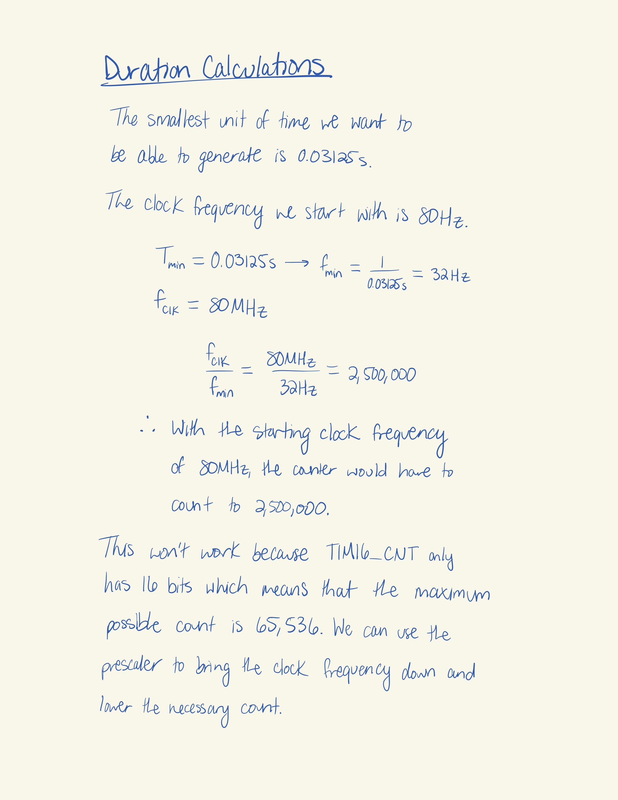
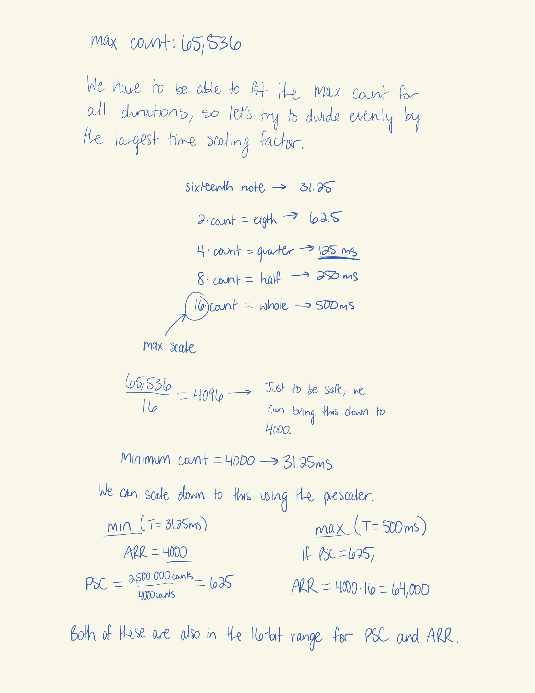
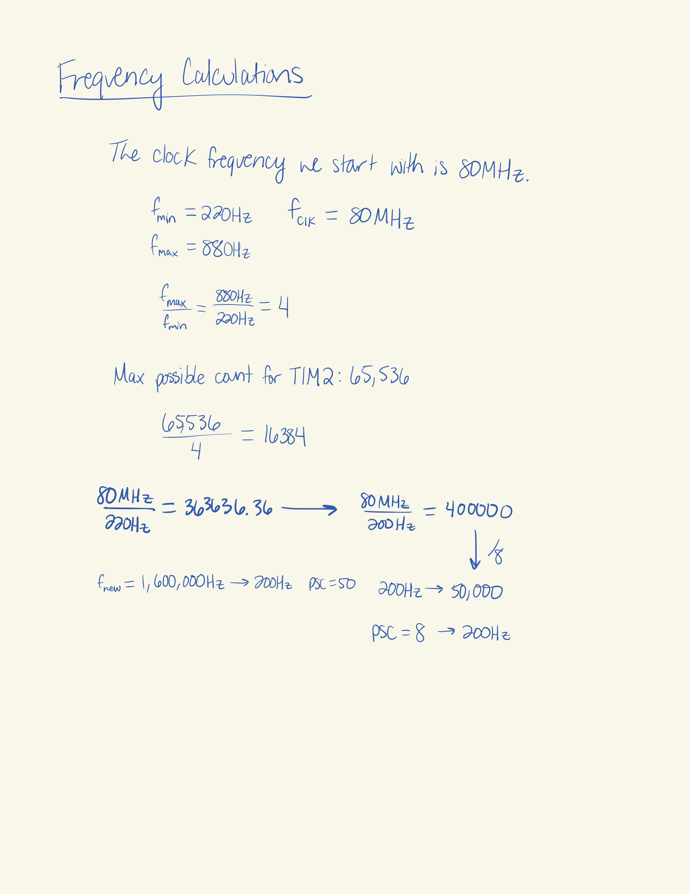
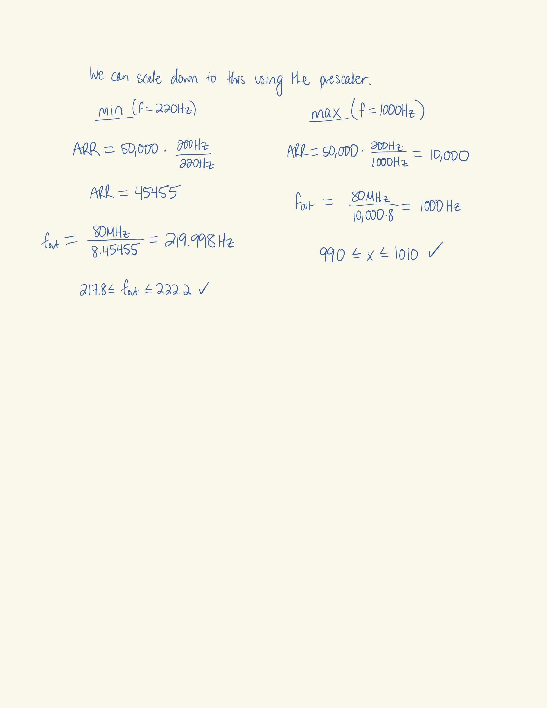
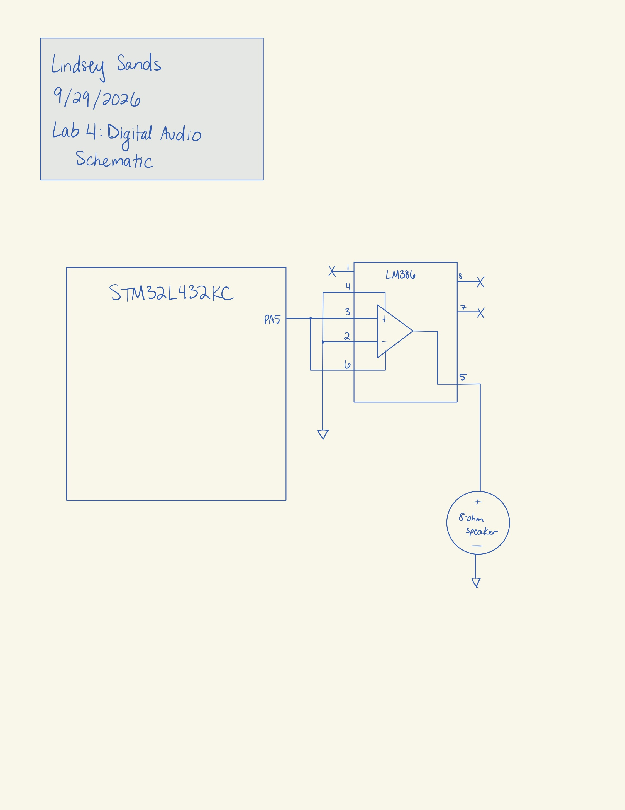

## Introduction
In this lab, an MCU was programmed to play music by varying output frequencies and durations.

## Design and Testing Methodology
In order to figure out the proper prescaler and auto reload register values, calculations were performed, as seen below.

{width=80%}

{width=80%}

{width=80%}

{width=80%}

## Technical Documentation
The source code for the project can be found in the associated [Github repository](https://github.com/lsands5400/e155-lab-4).

# Schematics

{width=80%}

## Conclusion
Thr program and circuit work. The MCU successfully outputted the song Fur Elise to an 8 ohn speaker. 

## AI Prototype Summary

For the timer, ChatGPT suggests "TIM2 in output-compare toggle mode". It mostly just does nto advise that you use TIM6/7 because they are too basic. 

For the specific pin, it lists GPIO: PA0

Timer: TIM2

Channel: CH1

Alternate function: AF1

Output mode: PWM or output compare

It also listed two alternate options, but it didn't list the one I used which is interesting.

It gives multiple options for PWM configuration and shows the formulas for each.
It lists all the regiters needed for TIM2 as well as the GPIO and RCC clock setup. Finally, at the end it lists links to the documentation. 

Overall, this AI output seems like it would give pretty accurate information for a good head start on the lab. 