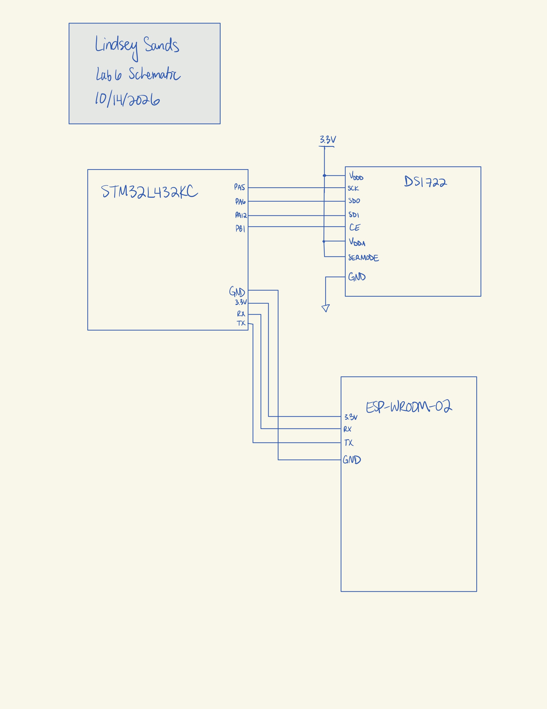
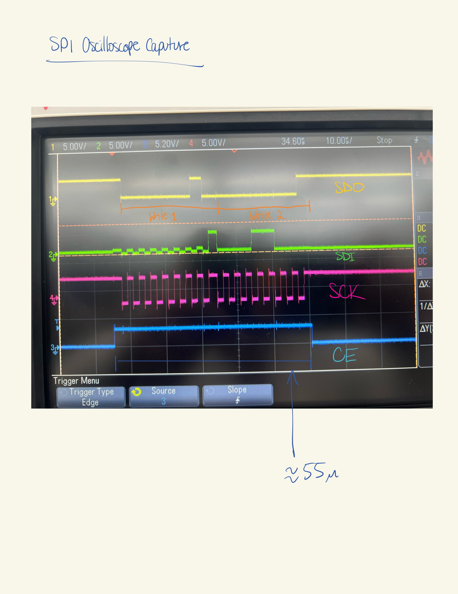

## Introduction
In this lab, an MCU was programmed to take temperature data from a Digital Thermometer with SPI/3-Wire Interface and send that data to the web using an ESP-WROOM-02.

## Technical Documentation
The source code for the project can be found in the associated [Github repository](https://github.com/lsands5400/e155-lab-6).

# Schematics
The connection from the MCU to the ESP-WROOM-02 and the temperature sensor is as shown below.

{width=80%}

## Results and Discussion
SPI successful sends and receives data from the temperature sensor as shown in the oscilloscope trace below.

{width=80%}

## Conclusion
The MCU successfully collects and outputs temperature data to the web! I spent about 15 hours on this lab. 

## AI Prototype Summary

::: {.callout-caution collapse="true" title="Click for Prompt 1 Results"}
<!DOCTYPE html>
<html lang="en">
<head>
  <meta charset="UTF-8">
  <meta name="viewport" content="width=device-width, initial-scale=1.0">
  <title>Thermo — Temperature Dashboard</title>

  
</head>

<body>
  <main class="container">

    <header>
      
thermo.

      
● Demo mode

    </header>

    <section class="heading">
      
Overview / Device 01

      <h1>Temperature monitor</h1>
      
Monitor your sensor and control your device outputs.

    </section>

    <section class="dashboard">

      <!-- Temperature display -->
      <article class="card">
        

          <h2>Live temperature</h2>
          ● Sensor active
        

        

          24.6
          °C
        

        

          ● Within normal range
        

        <!-- Decorative temperature trend -->
        

          <svg viewBox="0 0 500 110"
               preserveAspectRatio="none"
               aria-label="Illustrative temperature trend">
            <g stroke="#f1e8e3" stroke-width="1">
              <path d="M0 25 H500"/>
              <path d="M0 55 H500"/>
              <path d="M0 85 H500"/>
            </g>
            <path
              d="M0 80 C40 70,60 90,100 65
                 S160 75,200 48 S260 60,300 38
                 S360 50,400 25 S460 35,500 15"
              fill="none"
              stroke="#ff784f"
              stroke-width="3"
              stroke-linecap="round"/>
          </svg>
        

        
Illustrative recent temperature trend

      </article>

      

        <!-- LED control -->
        <article class="card">
          

            <h2>LED output</h2>
            GPIO
          

          

            
💡

            

              <strong id="ledState">LED is OFF</strong>
              
                Output is currently inactive
              
            

          

          

            

              <strong>LED power</strong>
              
Toggle the connected output

            

            <label class="switch" aria-label="Toggle LED">
              <input type="checkbox" id="ledToggle" role="switch">
              
            </label>
          

          

          

            This switch updates the interface. Connect it to your
            microcontroller API to control the physical LED.
          

        </article>

        <!-- Precision selector -->
        <article class="card">
          <h2>Display precision</h2>

          

            Choose how many decimal places appear in the temperature
            readout.
          

          <label for="precision" class="eyebrow">
            Decimal places
          </label>

          <select id="precision">
            <option value="0">0 decimal places</option>
            <option value="1" selected>1 decimal place</option>
            <option value="2">2 decimal places</option>
            <option value="3">3 decimal places</option>
          </select>

          

            Preview
            <strong id="precisionPreview">24.6 °C</strong>
          

        </article>

      

    </section>

    <footer>
      THERMO UI · Dashboard prototype · Demo readings are simulated
    </footer>

  </main>

  
</body>
</html>
:::

#include "stm32l432xx.h"
#include <stdint.h>
#include <stdbool.h>

/*
 * DS1722 temperature sensor
 *
 * MCU: STM32L432KC
 * Peripheral: SPI1
 * CE (chip enable): PA4
 *
 * IMPORTANT: DS1722 CE is ACTIVE HIGH.
 */

#define DS1722_SPI       SPI1
#define DS1722_CE_PORT   GPIOA
#define DS1722_CE_PIN    4U

#define DS1722_TEMP_LSB  0x01U

#define DS1722_CE_HIGH() \
    (DS1722_CE_PORT->BSRR = (1U << DS1722_CE_PIN))

#define DS1722_CE_LOW() \
    (DS1722_CE_PORT->BSRR = (1U << (DS1722_CE_PIN + 16U)))

#define SPI_TIMEOUT 100000U

/*
 * Transfer one byte over SPI.
 * Returns false if the SPI peripheral times out.
 */
static bool SPI1_TransferByte(uint8_t tx, uint8_t *rx)
{
    uint32_t timeout = SPI_TIMEOUT;

    // Wait until transmit buffer is empty.
    while (!(DS1722_SPI->SR & SPI_SR_TXE)) {
        if (--timeout == 0U) {
            return false;
        }
    }

    // Write one byte to the SPI data register.
    *(__IO uint8_t *)&DS1722_SPI->DR = tx;

    // Wait for one received byte.
    timeout = SPI_TIMEOUT;

    while (!(DS1722_SPI->SR & SPI_SR_RXNE)) {
        if (--timeout == 0U) {
            return false;
        }
    }

    // Read the received byte.
    *rx = *(__IO uint8_t *)&DS1722_SPI->DR;

    return true;
}

::: {.callout-caution collapse="true" title="Click for Prompt 2 Results"}
/*
 * Read temperature from the DS1722.
 *
 * Assumptions:
 * - SPI1 has already been initialized.
 * - SPI is configured as master, 8-bit, full duplex.
 * - CPHA = 1, as required by the DS1722.
 * - SERMODE is connected to VDDD (SPI mode).
 * - The sensor is configured for continuous conversion.
 *
 * Returns true on success, false on SPI timeout.
 * Temperature is returned in degrees Celsius.
 */
bool DS1722_ReadTemperature(float *temperature)
{
    uint8_t lsb;
    uint8_t msb;
    uint16_t raw;

    if (temperature == 0) {
        return false;
    }

    // Start transaction: CE must be HIGH.
    DS1722_CE_HIGH();

    // Send temperature LSB register address.
    if (!SPI1_TransferByte(DS1722_TEMP_LSB, &lsb)) {
        DS1722_CE_LOW();
        return false;
    }

    // Read temperature LSB.
    if (!SPI1_TransferByte(0xFFU, &lsb)) {
        DS1722_CE_LOW();
        return false;
    }

    // Read next register (temperature MSB).
    // The DS1722 automatically advances to register 0x02.
    if (!SPI1_TransferByte(0xFFU, &msb)) {
        DS1722_CE_LOW();
        return false;
    }

    // End transaction.
    DS1722_CE_LOW();

    // Combine MSB and LSB.
    raw = ((uint16_t)msb << 8) | lsb;

    // DS1722 data is signed, two's-complement,
    // with temperature represented in units of 1/256 °C.
    *temperature = (float)((int16_t)raw) / 256.0f;

    return true;
}
:::

The HTML result looks super similar to typical vibe-coded websites. It has a temperature value even when its not hooked up to the board which is suspiscious. 

The script from the second prompt didn't do everything. Instead, it lists its assumptions in the beginning and simply creates a script for the rest. I'm not sure why it skips so many steps and assumes I have information/work that I didn't offer up. Maybe this is a result of the increase in prompting over the years and represents an attempt to reduce costs on the AI company's end. 